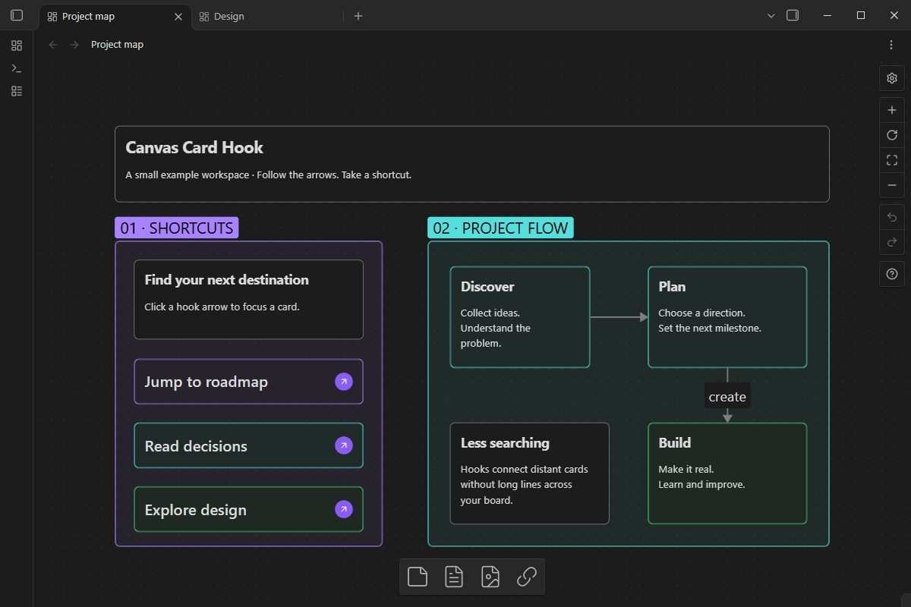
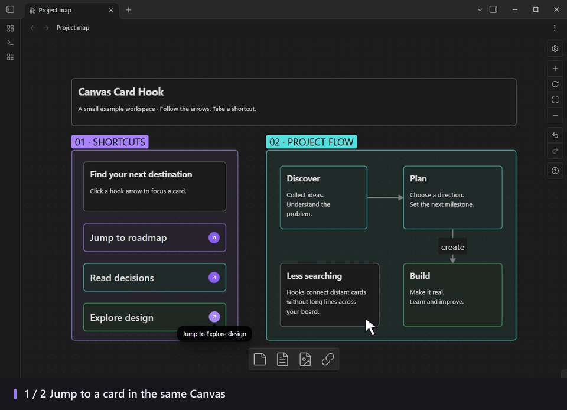
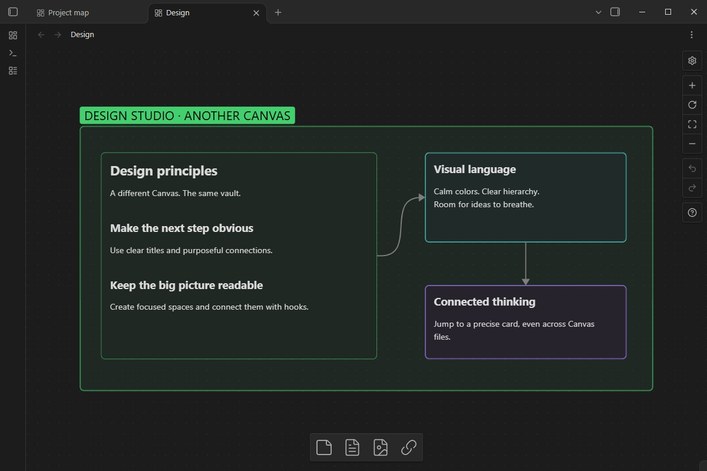
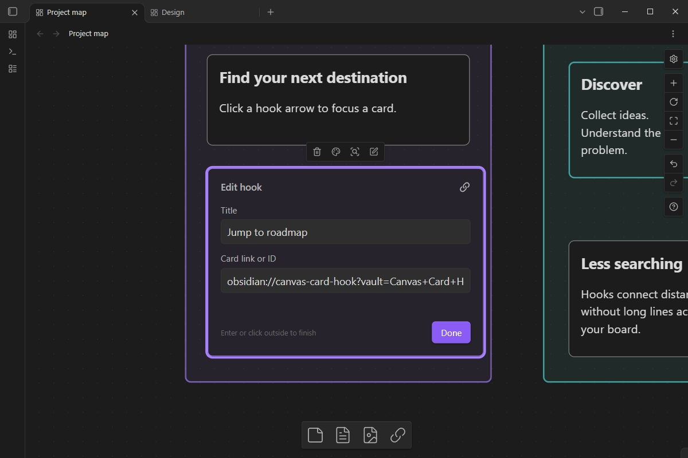

# Canvas Card Hook

**A Canvas card linker for Obsidian: create hook shortcuts, copy card links, and jump straight to the card you need.**

Canvas Card Hook adds small, clickable navigation cards to Obsidian Canvas. Link to a destination in the same Canvas or another Canvas in your vault. Click the arrow and Obsidian uses its native **Zoom to selection** to focus the destination.



Watch a hook jump to a distant card in the same Canvas, then open a specific card in another Canvas in the same vault. The animated pointer and click highlights make each action visible.



The screenshots and animation show version 0.2.0 in a fictional example workspace with groups, connections, and three hook shortcuts. They include the compact jump buttons, native card backgrounds, and the hook control in the bottom toolbar.

## Features

- **Add hook** in the native card context menu.
- **Add hook** when right-clicking empty Canvas space.
- A hook icon in the bottom Canvas toolbar: click to create a hook at the center, or drag it onto the Canvas.
- **Copy card link** for any destination card.
- Two inline fields: **Title** and **Card link or ID**.
- Click the arrow to jump; click the body to select or move the hook.
- Links within a Canvas and between canvases in the same vault.
- Native card movement, resizing, colors, connections, duplication, undo, and redo.
- A compact, centered arrow button and the same color background as native cards.
- A comfortable temporary editor size that restores your chosen card size afterward.
- Offline storage inside standard `.canvas` files, with a readable Markdown fallback.

## Installation

Find the plugin in the [official Obsidian Community directory](https://community.obsidian.md/plugins/canvas-card-hook), or install it from the app:

1. Open **Settings → Community plugins → Browse**.
2. Search for **Canvas Card Hook**.
3. Select **Install**, then **Enable**.

Publishing a GitHub release alone does not make the plugin searchable in Obsidian. Directory availability depends on the official review and publication process.

For manual installation, download `main.js`, `manifest.json`, and `styles.css` from the [latest release](https://github.com/Dhenyson/obsidian-canvas-card-hook/releases/latest). Place them in your vault's configuration directory under `plugins/canvas-card-hook/`, then reload Obsidian and enable the plugin. The default configuration directory is `.obsidian`.

## Create a card link

1. Right-click the **destination** card and choose **Copy card link**, or select one card and press **Ctrl+C**.
2. Right-click a card near where you want the shortcut and choose **Add hook**.
3. Enter a title and paste the copied reference into **Card link or ID**.
4. Click **Done**, press **Enter**, or click outside the card.
5. Click the arrow to jump to the destination.

The card on which you choose **Add hook** is only the placement anchor. It is not replaced, and it does not determine the destination.

You can also right-click **empty Canvas space → Add hook** to create a hook at that position. In the bottom toolbar, next to the native card, note, and media controls, click **Drag to add hook** to create a hook at the center of the visible Canvas, or drag the icon to place it precisely. Dragging uses native Canvas snapping. The toolbar icon also supports **Enter** and **Space** when focused. Creation is unavailable on read-only canvases.

Double-click the hook body or use the native **Edit** action to change its title or destination. Changes save as you type. Escape finishes editing; it does not discard changes.

## Jump between canvases

Copy the destination card link from **Canvas B**, then paste it into a hook in **Canvas A**. Both canvases must belong to the same vault. Clicking the hook opens or reveals Canvas B, selects the correct card, and applies native zoom to selection. An already-open destination Canvas is reused.

For cross-canvas links, use **Copy card link** or **Ctrl+C**, rather than a bare card ID. A raw 16-character card ID is resolved only within the hook's own Canvas. Cross-vault navigation is not supported.



## Compact cards and comfortable editing

Resize a hook to suit your layout. Its arrow stays centered even on short cards.

Hooks use the native Canvas content background, so standard and custom card colors apply just as they do to regular cards, including while editing. The jump button is a compact 28-pixel circle with a 16-pixel arrow.

While editing, the card temporarily becomes **380 × 260**, the same size as a new hook. Done, Enter, Escape, or clicking outside restores its exact previous width and height. Saves, clipboard data, and history retain the chosen preview dimensions while the editor is expanded.



## Copy and paste behavior

| Action | Result |
| --- | --- |
| Ctrl+C on one selected card | Copies native Canvas data and the original card link |
| Ctrl+V on the Canvas | Duplicates the card normally, with a new ID |
| Ctrl+V in a hook's target input | Inserts the original card reference |
| Copy card link | Copies a link without the native duplication payload |
| Copy several selected cards | Keeps normal multi-card copy without choosing an ambiguous target |

Two commands are also available from the command palette: **Copy selected card link** and **Add hook beside selected card**.

## Storage, renaming, and compatibility

Hook data is stored in the native text card's `text` field as a versioned JSON HTML comment followed by readable Markdown. There is no separate database. When the plugin is disabled, the title and destination link remain readable as ordinary Markdown.

Renaming a Canvas file or folder **inside Obsidian while the plugin is enabled** updates matching hook references in this vault. Files renamed externally, cards moved between canvases, renamed vaults, and deleted or recreated cards may require a new destination link. Links already copied to the system clipboard cannot be rewritten after a rename.

Read-only canvases permit navigation but prevent editing. **Convert to file** retains the title and destination link as Markdown; the result becomes an ordinary file card.

**Supported platform:** Obsidian Desktop 1.14.4 or later. Tested on Windows with Obsidian Desktop 1.14.4. Mobile and interactions with other Canvas plugins have not been verified.

Canvas rendering and viewport methods use internal Obsidian interfaces. Future Obsidian updates may require compatibility changes. The plugin reuses native zoom and restores its instance wrappers when unloaded.

## Privacy and access

- No network requests, telemetry, advertising, payment, or external service.
- No account or API key is required by the plugin.
- Clipboard data is written when you copy a card or choose **Copy card link**, and read from paste events inside the target input.
- Hook configuration is saved within Canvas files in the current vault. Rename handling updates affected hook links in that vault.
- No files outside the vault are accessed by the runtime plugin.

## Development and support

The project uses strict TypeScript with a deterministic CommonJS runtime build and no bundled runtime dependencies. Development and CI run the complete recommended Obsidian lint configuration, including type-aware rules, and fail on warnings. See [CONTRIBUTING.md](CONTRIBUTING.md) for setup and testing.

```sh
pnpm install --frozen-lockfile
pnpm typecheck
pnpm lint
pnpm test
pnpm build
```

The build produces `main.js` in the repository root and installable runtime files in `dist/canvas-card-hook/`. A Git tag matching the manifest version publishes the three installation assets through GitHub Actions after validation.

The local test suite contains seven unit tests and 76 integration checks in the real Obsidian app. See [TEST-RESULTS.json](TEST-RESULTS.json) and [CREATION-TEST-RESULTS.json](CREATION-TEST-RESULTS.json) for the tested behaviors. The creation checks cover native color matching in light and dark themes, the compact button, menu placement, toolbar clicks, keyboard activation, actual pointer dragging, read-only behavior, and unload/reload cleanup. They also verify visibility at several zoom levels without CSS important overrides. These checks are evidence of the tested release, not a promise that all themes or Canvas plugins are compatible.

Release workflows generate GitHub build-provenance attestations for all three installation files before publishing. See [Security and review notes](docs/SECURITY-REVIEW.md) for the remaining clipboard and vault access disclosures.

Report reproducible problems in [GitHub Issues](https://github.com/Dhenyson/obsidian-canvas-card-hook/issues). See the [changelog](CHANGELOG.md) for release history.

Related terms: Canvas linker, card links, hook cards, jump shortcuts, Canvas navigation, and zoom to selection.

## License

[MIT](LICENSE). An independent community plugin, not an official Obsidian product.
